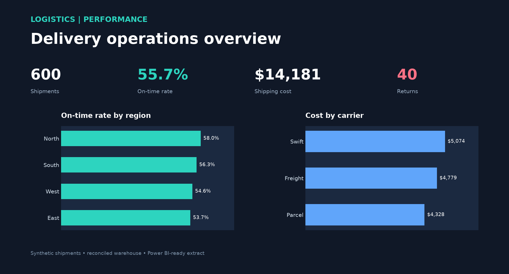

# Logistics Analytics Platform

A repeatable shipment ETL and star-schema model for comparing delivery timeliness and shipping costs by region and carrier. All data is synthetic and generated with a fixed seed.



`Fixed-seed shipments → validation → source table → date/region/carrier dimensions + shipment fact → reconciliation → Power BI CSV + PBIX dashboard`

The grain is one row per `shipment_id`. A shipment is on time when `delivered_date <= promised_date`. `On-Time %` divides on-time delivered shipments by all delivered shipments in the selected filter context. Returns count a `returned` flag; they are not deducted from shipping cost. The generated dataset has no missing or cancelled deliveries.

## Offline quick start

Use Python 3.13 from this directory:

```powershell
python -m venv .venv
.venv\Scripts\python.exe -m pip install -r requirements.txt
.venv\Scripts\python.exe logistics.py
.venv\Scripts\python.exe build_preview.py
.venv\Scripts\python.exe -m pytest -q
```

The ETL creates `data/shipments.csv`, a regenerable DuckDB file, `artifacts/powerbi_shipments.csv` and `artifacts/summary.json`. Re-running replaces the same tables and preserves counts. Open the native [Power BI report](assets/logistics-analytics.pbix) for KPI cards, carrier cost, and regional on-time charts. The report embeds the checked-in shipment CSV, so it opens without a database connection. Follow [POWER-BI-BUILD-GUIDE.md](POWER-BI-BUILD-GUIDE.md) for measure definitions and layout. `assets/logistics-preview.png` is a reproducible static preview.

## PostgreSQL path

`postgres/schema.sql` defines the equivalent star schema with primary/foreign keys. Set a local `PORTFOLIO_PG_DSN` environment variable for a PostgreSQL database you control, then run `python load_postgres.py`. It truncates and reloads only the `portfolio_logistics` schema's five tables; do not point it at a database where those tables contain data you need to keep. The loader checks source/fact row counts and shipping-cost totals in the same transaction. Credentials are never stored in this repository. The installed PostgreSQL service on the authoring machine requires a password unavailable to this checkout, so that path is provided but has not yet been run against that service.

The offline DuckDB run checked 600 source and fact shipments, $14,180.77 cost in each, zero reconciliation difference, 55.67% on-time rate and 40 returns. `tests/test_logistics.py` verifies idempotence, an independently calculated three-shipment KPI case, extract row counts and duplicate rejection.
